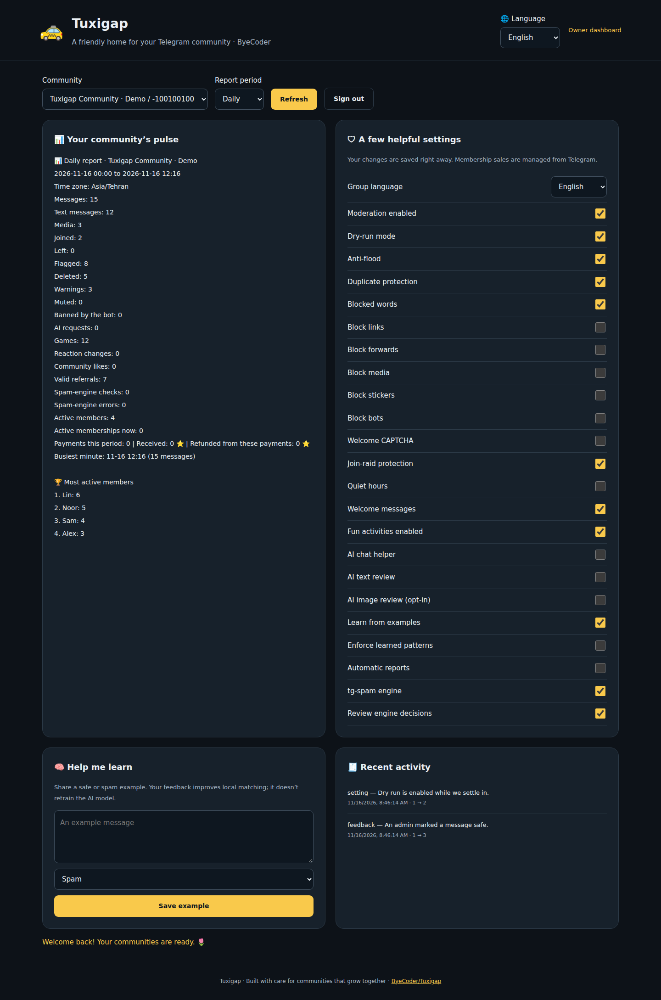

# 🚕 Tuxigap — your community, together

[](https://github.com/ByeCoder/Tuxigap/actions/workflows/ci.yml)
[](https://www.python.org/)
[](LICENSE)

**A friendly Telegram community toolkit by [ByeCoder](https://github.com/ByeCoder).**

Meet **Tuxigap** (تاکسی گپ): moderation, community games, useful analytics, an AI helper, and paid memberships in one project. Start with the inline Telegram panel; add an owner dashboard, the real **tg-spam** engine, or the full **Telegram Bot Studio** companion when you're ready.

**English is the default** for the bot, dashboard, and documentation. Choose another interface language with `/language` or **Settings → Language**. Your own rules, notes and posts stay exactly as you wrote them.

> **Release 0.5.0 · integration testing matters.** Automated tests cover local behavior and mocked service contracts. Please complete the [live test guide](docs/LIVE_TEST.md) before real moderation or paid sales. New groups start in dry-run mode so you can settle in safely.

## Find your way around

[Try the demo](#take-a-test-drive) · [Quick start](#get-your-bot-running) · [All-in-one suite](#bring-the-whole-suite) · [Features](#what-you-can-do) · [Languages](#make-yourself-at-home) · [Commands](docs/COMMANDS.md) · [AI](docs/AI.md) · [Payments](docs/PAYMENTS.md) · [Source integration](docs/INTEGRATION.md) · [Operations](docs/OPERATIONS.md) · [Troubleshooting](docs/TROUBLESHOOTING.md)

## Take a test drive

You can explore the dashboard without a bot token, AI key, Telegram account, or payment:

```bash
git clone https://github.com/ByeCoder/Tuxigap.git
cd Tuxigap
python -m venv .venv
source .venv/bin/activate
pip install -e .
python -m tuxigap.demo
```

Open **http://127.0.0.1:8088**, paste the temporary owner key printed in your terminal, and have a look around. The demo includes a year of synthetic activity and a few friendly sample members. It makes **no Telegram, AI, or payment requests**. Everything is temporary; press `Ctrl+C` when you're done.

On Windows, activate the environment with `.venv\Scripts\activate`.

<details>
<summary>Have a peek at the owner dashboard</summary>



You can also open the [mobile preview](docs/images/dashboard-mobile.png). These are real browser captures from our [passing checks](https://github.com/ByeCoder/Tuxigap/actions/runs/43833871701), using demo data only.

</details>

## Get your bot running

### A comfortable first setup

You'll need a Telegram bot from **[@BotFather](https://t.me/BotFather)** and either **Docker with Compose** or **Python 3.12+**.

```bash
git clone https://github.com/ByeCoder/Tuxigap.git
cd Tuxigap
python tools/configure.py
```

The setup helper asks for your bot token, optionally your numeric Telegram ID and group ID, and generates strong private dashboard/engine keys. It writes a private `.env` file and **doesn't overwrite an existing one**. No credentials are sent anywhere during setup.

Prefer to edit settings yourself? Copy `.env.example` to `.env` and fill in `BOT_TOKEN`.

### Docker: start with the core bot

```bash
docker compose up -d --build
docker compose logs -f --tail=100
```

### Python: run directly

```bash
python -m venv .venv
source .venv/bin/activate
pip install -e .
python -m tuxigap --check
python -m tuxigap
```

### Say hello to your community

1. Start a private chat with your bot and send `/start`.
2. Add it to a **supergroup** as an administrator.
3. Grant **Delete messages**, **Ban/restrict users**, **Invite users**, and optionally **Pin messages**.
4. Send `/panel` in your group. Explore the inline buttons and keep **Dry-run mode** on while checking your rules.
5. Choose **Settings → Language**, or send `/language en`, `/language fa`, `/language zh`, and so on.
6. Configure blocked words and flood limits. When the results look right, turn dry run off for automatic enforcement.

For a channel, make the bot an admin and send `/connect -100…` in its private chat. Grant **Post messages** for scheduled posts and **Invite/restrict users** for paid access.

For `@YourBot query` inline mode, enable `/setinline` in BotFather. This public mode shares a joke or an invitation to play; it doesn't expose private analytics.

**One polling process owns each bot token.** Tuxigap won't silently remove an existing webhook, and the same token must not also run in Studio or a legacy bot.

## Bring the whole suite

The repository includes optional Compose files so you can use the larger toolkit from one checkout:

| Component | What it adds | Local address | Storage |
|---|---|---|---|
| Tuxigap core | Inline moderation, games, AI, analytics, paid access | Telegram | `tuxigap-data` |
| Owner dashboard | Analytics, safe settings, training and audit activity | `127.0.0.1:8080` | Same Tuxigap database |
| Real tg-spam engine | Specialized detection, sample management, CAS/Lua through engine configuration | `127.0.0.1:8081` | Separate `spam-data` |
| Full Studio companion | Upstream CRM, support desk, flow builder, Mini Apps, commerce and automation | `127.0.0.1:3000` | Separate `studio-data` |

After `python tools/configure.py`, you can run:

```bash
python tools/manage.py up --all
python tools/manage.py status --all
python tools/manage.py logs --all
```

Or use Compose directly:

```bash
docker compose \
  -f docker-compose.yml \
  -f docker-compose.web.yml \
  -f docker-compose.engines.yml \
  -f docker-compose.studio.yml \
  up -d --build
```

**A small but important distinction:** Studio is the **full upstream application**, pinned to a source commit and deployed as a companion. Its CRM and Mini App features are not disguised as native Tuxigap commands. Add a **different BotFather token** in Studio, and keep duplicate moderation modules off when both bots share a group. Its login, database, languages and billing features remain separate.

For tg-spam, set a group-to-engine mapping in `.env`:

```dotenv
SPAM_ENGINES={"-1001234567890":"http://spam-engine:8080"}
SPAM_ENGINE_PASSWORD=YOUR_STRONG_RANDOM_PASSWORD
```

Give each group its **own engine endpoint and volume**. The adapter rejects duplicate endpoint mappings so training data isn't accidentally shared. The engine gets **no Telegram token**; Tuxigap remains in charge of Telegram actions. Engine decisions start in human-review mode.

See [advanced setup](docs/ADVANCED.md) for individual components, access keys, HTTPS, and the optional Studio companion.

## Make it your community

Version **0.4** adds a dedicated staff hub, owner-assigned bot roles, customizable XP ranks, member tags, persisted join-request review, colored buttons and custom emoji, channel tools, call invitations and five shared group games.

```text
/staffpanel
/theme primary
/buttonemoji YOUR_CUSTOM_EMOJI_ID
/template welcome [emoji:YOUR_ID|🌷] Welcome, {name}!
/joinmode trusted
/party number
```

Explore [staff, ranks, tags and membership](docs/COMMUNITY.md), [buttons and custom emoji](docs/APPEARANCE.md), [group games](docs/GAMES.md), and the [changelog](CHANGELOG.md). Telegram eligibility applies to custom emoji. Call tools track events, share links and assign human hosts; starting/ending a call stays in Telegram’s own controls. An [optional helper-account music worker](docs/MUSIC.md) now adds audio playback and queue controls.

## More smiles, more music

Version **0.5** brings [240 multilingual jokes](docs/HUMOR.md), including **80 Persian jokes**, with nonrepeating decks, language buttons, likes, favorites and reviewed member suggestions. Try `/jokes fa student` or `/jokelanguages`.

The optional [music worker](docs/MUSIC.md) plays a local library or Telegram audio attachment in an existing call, with queue, pause/resume, skip, stop, shuffle, repeat and volume controls. It needs **your own helper user account session**, FFmpeg, an allowlisted group and an active call. The bot token alone cannot stream into a call. Live call playback has not been tested with a real account here.

```text
/jokes fa
/jokes any
/jokefavorites
/music
# Reply to a Telegram audio attachment:
/mplay
/mqueue
```

## What you can do

| Area | Available features |
|---|---|
| **Optional call music** | PyTgCalls/Telethon helper, Telegram audio or local library, persistent queue/control jobs, pause/resume, skip/stop, volume, repeat and shuffle |
| **Multilingual humor** | 240 offline jokes, 15 languages, 80 Persian lines, per-chat decks, likes, favorites and staff-reviewed suggestions |
| **Staff & identity** | Inline staff hub, owner-assigned manager/moderator/editor/host/analyst roles, protected hierarchy, actual admin presets, custom rank ladders and member tags |
| **Arrivals & requests** | Welcome/goodbye templates, observed presence, persistent accept/decline buttons, optional automatic/trusted approval and paid/federation checks |
| **Appearance** | Blue/green/red Telegram button styles, custom emoji icons, safe emoji text markers and ordinary-emoji fallback |
| **Calls & channels** | Call events/invitations, human call hosts, channel/group post/edit/delete/pin, title/description and linked-community information |
| **Shared group games** | Guess the number, scramble, riddles, math sprint, word chain, persistent scores and 240 offline jokes in 15 languages, including 80 Persian jokes |
| **Inline administration** | Settings, member action buttons, bans/unbans, timed mutes/unmutes, warnings, warning reset, delete, pin, emergency lockdown and permission restore |
| **Content protection** | Flood and duplicate checks, Persian/Arabic text normalization, blocked words/phrases, hidden links, forwards, media, stickers and bots |
| **Advanced locks** | 40+ ported Studio lock types: contact, phone, email, polls, albums, custom emoji, animated/premium stickers, inline bots, forward types, scripts and more |
| **Scoped allowlists** | Exact domains/subdomains, sticker packs, commands, inline bots and forwarding sources; allowing a domain doesn't allow unrelated media |
| **Community safety** | Join-raid detection, welcome CAPTCHA, configurable quiet hours and trusted-member exemptions |
| **Federations** | Owner-approved group membership, shared bans, persistent fan-out jobs, live admin protection and stale-job handling |
| **Human-guided learning** | `/spam`, `/ham`, review buttons, group-specific samples, similarity matching and queued feedback to the real spam engine |
| **AI helper** | `/ask`, optional recent-message context, public-note retrieval, conversation summaries, admin-generated quizzes and opt-in image review |
| **Analytics** | Daily/weekly/monthly/yearly calendar reports, active members, join/leave events, moderation counters, games, referrals, AI/engine usage and Stars totals |
| **Reporting** | Automatic completed-period reports, latest-period catch-up, durable deduplication and private CSV exports |
| **Games & fun** | Competitive quizzes, rock-paper-scissors, dice, coin toss, 8-ball, decisions, emoticons, bounded text-art, jokes, truth/dare and playful fortunes |
| **Keep people involved** | XP, levels, game coins, badges, streak-based daily rewards, personal referral links, referral rankings and free giveaways |
| **Helpful chat tools** | Welcome messages, group rules, public notes, exact-phrase auto-replies, member reports and AFK notices |
| **Channel content** | Channel connection, future posts, scheduled-post cancellation and private access plans |
| **Paid memberships** | Stars invoices, fixed terms, 30-day recurring terms, purchaser/price checks, access recovery, expiry, cancellation, support and refunds |
| **Reliability** | SQLite/WAL, additive schema migration, persistent update inbox, a separate payment lane, retry queues, backup and health checks |
| **Operations** | Non-root Docker image, loopback-only dashboards, setup helper, suite launcher, offline demo and CI |

See the [feature matrix](docs/FEATURES.md) and [source integration notes](docs/INTEGRATION.md) for exact boundaries. We aim for useful, working integration—not a promise that every historical module in every upstream repository works unchanged.

## Make yourself at home

English is the reference and default. These language choices are available:

| Code | Language | Code | Language | Code | Language |
|---|---|---|---|---|---|
| `en` | English | `fa` | فارسی / Persian | `zh` | 中文 / Chinese |
| `ru` | Русский / Russian | `he` | עברית / Hebrew | `es` | Español / Spanish |
| `fr` | Français / French | `ar` | العربية / Arabic | `de` | Deutsch / German |
| `tr` | Türkçe / Turkish | `pt` | Português / Portuguese | `hi` | हिन्दी / Hindi |
| `ja` | 日本語 / Japanese | `ko` | 한국어 / Korean | `it` | Italiano / Italian |

- `/language` in private chat changes **your personal interface**.
- `/language CODE` in a group changes **that group's interface** and requires a current admin.
- The owner dashboard has its own interface selector and a separate group-language setting.
- Persian, Arabic and Hebrew use RTL in the dashboard.
- AI answers and generated quizzes use the group's selected language.
- Languages share the same features. **Translation coverage varies**: English and Persian cover the full reference catalog; other languages localize core menus and use friendly English for missing advanced messages. Bonus word/riddle rounds remain English; the separate joke packs now cover all 15 languages. Nothing depends on a live translation service.
- Admin-authored rules, posts, notes and historical audit content are not automatically translated.

Want to help improve a translation? [Here's the short guide](docs/LANGUAGES.md). The check script verifies interpolation placeholders so names, prices and dates stay safe.

## A few everyday examples

### Teach a community rule

Open **Moderation & safety → Edit blocked words**. Put one word or phrase on each line. Matching uses whole words by default; prefix `*` to match inside longer words too.

Reply to a message with `/spam` or `/ham` to provide a labeled example. These commands **teach**; they don't silently delete the original message. Use `/delete` for an explicit removal.

### Manage a member with buttons

Reply to the member's message and send `/manage`. You'll get warning, mute, unmute, delete, ban and training buttons. Permissions are checked again when a button is used; admins and the bot are protected.

### Add a useful note or reply

From **Content & scheduling**:

```text
Public note:
welcome | Please be kind, stay curious, and help each other learn.

Auto-reply:
meeting time | Our next community catch-up is Tuesday at 18:00 UTC.

Scheduled post:
2027-01-15 18:30 | Hello, everyone! It's time for our weekly catch-up.

Poll:
What shall we explore next? | Gardening | Robotics | Data science

Free giveaway:
Community star badge | 60
```

Use `Name | -` to remove a note or auto-reply. Your timezone setting controls scheduled local times.

### Build a federation

```text
Private chat: /fedcreate Our Friendly Communities
Group owner: /fedjoin FEDERATION_ID
Federation owner: approve the request button
Federation owner in a linked group: /fban MEMBER_ID Reason
Undo a federation decision: /funban MEMBER_ID Reason
Group owner: /fedleave
```

Unbanning doesn't knowingly override a manual ban or an expired paid-membership gate. See [federations](docs/COMMANDS.md#federations) for the trust model.

## Add your AI helper

Set `AI_API_KEY`, `AI_MODEL`, and, if needed, `AI_BASE_URL` in `.env`. Your provider needs an OpenAI-compatible Chat Completions endpoint and JSON-object responses for moderation/quizzes. Pick a model your provider actually offers.

Then open **AI & learning**:

- Enable chat help for `/ask`.
- Set context history to `0–20`; **zero is the default**.
- Use public notes as a small community knowledge base.
- Enable image review only if your model supports vision and your community is comfortable with images going to that provider.
- `/aiquiz TOPIC` is for current admins. `/summary` needs context enabled.

AI text/image flags go to **human review**. Local flood, word and content rules keep working if a provider is unavailable. Quotas count requests, **not a guaranteed currency budget**. Learn more in [AI & learning](docs/AI.md).

## Offer paid access

1. Make your group or channel **private** and revoke old uncontrolled invite links.
2. Set `SUPPORT_USERNAME` and `TERMS_URL` in `.env`.
3. Create a plan from **Membership sales**:

   ```text
   Monthly | 100 | 30 | 0
   ```

   The last number is `1` for automatic 30-day renewal or `0` for a fixed term.

4. Review the terms, then enable the membership gate with its confirmation button.
5. Share the shop link shown in **View plans**.

Access is recorded only after Telegram's **successful payment** update. The bot verifies the buyer and price, deduplicates charge IDs, and sends a join-request link. Forwarding that link doesn't give another account access.

Members can use `/subscriptions` to recover links or cancel renewal. An authorized admin can request `/refund CHARGE_ID` and confirm it. Refunding a recurring plan also cancels its future renewal.

**Game coins are just for fun.** They cannot be bought for cash, withdrawn, or converted into Stars. Giveaways have free entry, and admins fulfill any prize they describe.

Please read [payments and access](docs/PAYMENTS.md) and finish the [live payment tests](docs/LIVE_TEST.md) before selling to real members.

## Understand your reports

Reports use **Gregorian calendar periods** and the group's timezone, initially `Asia/Tehran`. Weeks start on Saturday unless you change the setting. Reports begin from events the bot actually receives; we don't invent historical analytics.

Manual reports show the current period. Automatic reports show the latest completed day, week, month and year, with durable deduplication. On first enablement, each completed period can be sent once; periods without data show zero.

Minute buckets preserve half-hour timezone boundaries. CSV exports contain UTC metric buckets; text reports also show active-member totals, rankings and Stars figures. Historical member identity rows affect active-member analytics; `/forget` can remove those personal rows while aggregate counters remain.

## Keep your community running

```bash
# Check settings/database without Telegram or AI requests
python -m tuxigap --check

# Consistent backup while SQLite is running
python -m tuxigap --backup backups/tuxigap-2026-11-16.sqlite3

# Docker backup inside the persistent volume
docker compose exec tuxigap python -m tuxigap --backup /app/data/backup.sqlite3

# Stop the core bot, keeping persistent data
docker compose down
```

Don't copy a live SQLite file with plain `cp`; use the backup command. Keep backups private. Before upgrading from 0.2, make a backup; schema versions 1–3 upgrade additively to version 4. Never run an older release against a newer schema.

[Operations](docs/OPERATIONS.md) covers restores, queues, storage, secrets, logging, health, proxies, and deployment boundaries.

Music stays an explicit opt-in: follow [MUSIC.md](docs/MUSIC.md), then use `python tools/manage.py up --music`. It is not silently included in `--all`.

## Develop with us

```bash
pip install -e '.[dev]'
ruff check tuxigap tools tests
ruff format --check tuxigap tools tests
python -m unittest discover -s tests -v
python tools/check_translations.py
```

The 133 tests use fake Telegram/AI responses and local HTTP servers. They do not move real Stars or moderate real communities. CI checks Python 3.12/3.13, builds the Docker image, and exercises the dashboard in Chromium, including language switching and mobile layout. [Validation](docs/VALIDATION.md) records what was actually run.

Please keep `.env`, database files, backups, real user data and payment IDs out of commits. You'll find friendly contribution and security notes in [CONTRIBUTING.md](CONTRIBUTING.md) and [SECURITY.md](SECURITY.md).

## A clear view of the boundaries

- The native bot is one polling process with SQLite, intended for independently hosted communities. Large-scale load testing is still needed.
- Telegram doesn't expose a complete historical member list or full old message history through the Bot API. Other bots' messages are generally unavailable.
- Existing untracked members aren't automatically purged when paid access is enabled.
- A webhook, another poller, missing admin permission, or a removed bot can stop delivery/enforcement.
- SQLite commits and Telegram actions aren't one atomic transaction. A crash at the wrong moment may duplicate a notice or scheduled post; confirmed payment charges are deduplicated.
- Learning means labeled examples and similarity/context, **not autonomous fine-tuning** or reading every manual deletion.
- Image review is optional AI assistance, not a guarantee to catch every image or every form of abuse.
- Automatic migration from a basic group ID to a new supergroup ID is not implemented. Start with a supergroup.
- The native core does not include every legacy anime/download/weather module. Voice-chat music is an optional separately authorized MTProto worker, not a Bot API-only feature. Studio's broader features are available through the separate companion, with its own setup and language coverage.
- Translation coverage and service integration status are documented openly; please help us polish them rather than assuming an unchecked feature is production-ready.

## Credits and license

Tuxigap is developed by **ByeCoder**. This release includes credited adaptations from **Zero Two**, **AstrakoBot**, and **tg-bot-studio**, plus an optional real **tg-spam** service. See [THIRD_PARTY_NOTICES.md](THIRD_PARTY_NOTICES.md), the pinned [upstream manifest](third_party/upstream-lock.json), and each preserved license.

**Version 0.5.0 is distributed under GPL-3.0-only** because it now includes GPL-covered adaptations. Earlier original Tuxigap code was published under MIT; its notice is preserved in `third_party/tuxigap-v0.2/LICENSE`. Please preserve upstream attribution and license notices when sharing your version.

Thanks for building kind, lively communities with us. 🌷
