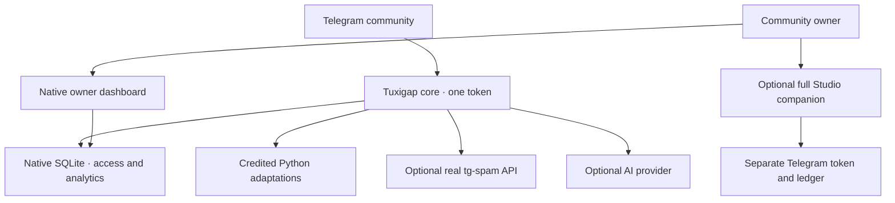

# How the sources fit together

This release integrates real code and real service contracts, while keeping incompatible runtimes and polling owners separate.

## Native adaptations

**Zero Two:** selected coin-toss/decision/8-ball/emoticon data is used by native `/toss`, `/decide`, `/8ball` and `/emote` flows.

**AstrakoBot:** the text-art/shout algorithm is adapted into `/shout`, with an output bound and no legacy dispatcher requirement.

**tg-bot-studio:** the content-lock evaluator is ported into the native moderation path, with 40+ lock names. UTF-16 entity slicing and strict domain checks address integration details that a blind copy would miss. Allowlisting a domain doesn't bypass unrelated photo/sticker/content locks.

The credited files are in `tuxigap/ported/`, with licenses and pinned provenance in `third_party/`. The combined release is GPL-3.0-only.

## Real tg-spam service

`SpamEngine` sends authenticated checks to the actual Go engine and queues labeled samples for it. The service has its own database and UI, no Telegram token, and one endpoint per Tuxigap group. This preserves access to the detector's own sample/dictionary/CAS/Lua configuration rather than pretending a handful of Python rules equals the full detector.

Native controls and AI review continue when the engine is unavailable. Engine decisions begin in review mode. Configure and test your engine's own features and credentials separately.

## Full Studio companion

`docker-compose.studio.yml` builds the entire pinned upstream application. That is the route to upstream CRM, support workflows, commerce, Mini Apps and flow-building features that aren't native Tuxigap commands.

Studio uses a **different bot token**, login, database, payment ledger and translation system. The native admin panel can link to `STUDIO_URL`; that link isn't a single-sign-on bridge or an assertion of shared state. If the two bots share a group, avoid competing moderation modules.

## What isn't a safe literal merge

Old bots use different Telegram libraries, schemas, Python versions and assumptions. Importing their entire handler trees would add duplicate polling, conflicting message actions and developer-only shell/eval behavior. Those handlers aren't included. Useful safe features are adapted and tested; entire modern applications are offered as clearly identified companions.

This is a practical integrated suite, not a claim that every legacy anime/downloader/weather handler now runs under one token. The [feature matrix](FEATURES.md) and [validation record](VALIDATION.md) are the source of truth.

References: [tg-spam](https://github.com/umputun/tg-spam), [Studio](https://github.com/sametcn99/tg-bot-studio), [Zero Two](https://github.com/Black-Bulls-Bots/zerotwobot), [AstrakoBot](https://github.com/Astrako/AstrakoBot), [Shield](https://github.com/redstone-md/shield).
